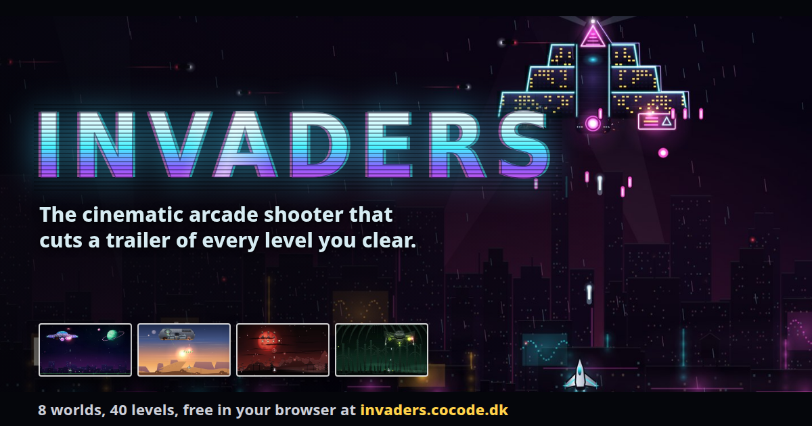

# Invaders

A cinematic arcade shooter for the browser. Fly anywhere in the lower half of the screen, shoot down
alien formations and beat a boss at the end of every world: 8 worlds and 40 levels, each world with
its own look, music and one rule only it has. Spread shot, laser, rapid fire, shield and smart bombs
along the way, and combos for the score.

Clear a level and the game cuts a movie trailer from your own run, title cards and all. The Cinema
on the title screen keeps your best run of every level. Lose one and you get the blooper instead.

[](https://invaders.cocode.dk)

## Play

**[invaders.cocode.dk](https://invaders.cocode.dk)**: free, nothing to install. Keyboard or mouse.

## Controls

| Action | Keyboard | Mouse |
|---|---|---|
| Move | Arrows or WASD | the ship follows the pointer |
| Fire (hold for auto-fire) | Space | left button |
| Smart bomb | B or Shift | right button |
| Pause | P or Esc | |
| Mute | M | |
| Confirm in menus | Enter | click |

Any key skips a trailer. "Watch, then try" on the title screen shows each move before you play.

## Run locally

Plain HTML, CSS and JavaScript modules: no dependencies, no build step, no network requests at
runtime. Every URL is relative, so the folder also works under a sub-path.

```sh
git clone https://github.com/cocodedk/invaders.git
cd invaders
python3 -m http.server 8000   # then open http://localhost:8000/
```

Any static file server works. Opening `index.html` straight from disk does not, because browsers
block ES modules on `file://`.

## Tests

```sh
npm test
```

Node 22 or newer, nothing to install. The suites cover the simulation (formations, bosses, bullet
patterns, replays that re-simulate a run exactly) and the effects state; a repo test keeps every
code file under 200 lines and the game free of external URLs. The design spec and build plan are in
`docs/superpowers/`.

## Contributing

See [CONTRIBUTING.md](CONTRIBUTING.md). Security reports go through [SECURITY.md](SECURITY.md).

## Author

**Babak Bandpey** — [https://cocode.dk](https://cocode.dk) | [LinkedIn](https://linkedin.com/in/babakbandpey) | [GitHub](https://github.com/cocodedk)

## License

Apache-2.0 | © 2026 [Cocode](https://cocode.dk) | Created by [Babak Bandpey](https://linkedin.com/in/babakbandpey)
